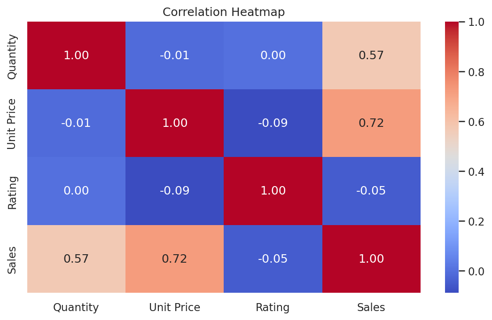

# Supermarket Sales Analysis

A Python data analysis project on 500 supermarket sales transactions, built for the **AICTE | IBM SkillsBuild Data Analytics with AI Internship 2026 (BharatCares)**.

**Author:** Gajanan Harinarayan Raje
**Institution:** MGM's College of Computer Science & IT, Nanded (SRTMU University)

---

## Project Description
The project loads supermarket sales data, checks it for missing or incorrect values, confirms that Sales = Quantity x Unit Price, summarises sales with totals, counts and averages, draws charts, and ends with business decisions. It shows which branches, categories, products, customer types and payment methods bring the most sales.

## Dataset
- **File:** [`supermarket_sales.csv`](supermarket_sales.csv) (included in this repository)
- **Size:** 500 transactions, 13 columns, 1 January 2026 to 1 July 2026
- **Source:** Data provided for the *Supermarket Sales Analysis DA project* in the IBM SkillsBuild Data Analytics with AI internship (Masterclass 4). Project workbook: [Google Doc](https://docs.google.com/document/d/1DVCIE1WCNGpbBrVBIfEkqaN6Qw9lJkCS_p-P5zeQV7Q/edit)

| Column | Description |
|---|---|
| Invoice ID | Unique invoice number |
| Date | Date of sale |
| Branch, City | A Jaipur, B Delhi, C Mumbai, D Bengaluru |
| Customer Type, Gender | Member or Normal; Male or Female |
| Product, Category | 20 products in 8 categories |
| Quantity, Unit Price | Units bought and price per unit |
| Payment | UPI, Net Banking, Card or Cash |
| Rating | Customer rating (3.0 to 5.0) |
| Sales | Invoice value (Quantity x Unit Price) |

## Technologies Used
- Python 3.9+
- pandas and NumPy (data checking and summaries)
- Matplotlib and Seaborn (charts)
- Jupyter Notebook

## Repository Files
| File | Purpose |
|---|---|
| [`Gajanan_Raje_SupermarketSalesAnalysis.ipynb`](Gajanan_Raje_SupermarketSalesAnalysis.ipynb) | Complete analysis code |
| [`supermarket_sales.csv`](supermarket_sales.csv) | Dataset |
| [`requirements.txt`](requirements.txt) | Python libraries needed |
| [`Gajanan_Raje_ProjectReport.docx`](Gajanan_Raje_ProjectReport.docx) | Full project report |
| `README.md` | This file |
| `1_Sales_by_City.png` to `7_Correlation_Heatmap.png` | The 7 charts from the analysis |

## Setup and Run

**Option 1: Google Colab (easiest)**
1. Open [colab.research.google.com](https://colab.research.google.com) and choose **File > Upload notebook**.
2. Upload `Gajanan_Raje_SupermarketSalesAnalysis.ipynb`.
3. Upload `supermarket_sales.csv` in the Files panel on the left.
4. Choose **Runtime > Run all**.

**Option 2: On your computer**
1. On this page click **Code > Download ZIP** and extract it.
2. Open a terminal in the extracted folder and run:
```bash
pip install -r requirements.txt
jupyter notebook
```
3. Open `Gajanan_Raje_SupermarketSalesAnalysis.ipynb` and choose **Kernel > Restart & Run All**.

Keep `supermarket_sales.csv` in the same folder as the notebook.

## Analysis Steps
1. Load the CSV data
2. Check for missing or incorrect values
3. Calculate Sales = Quantity x Unit Price and compare with the Sales column
4. Group and summarise using totals, counts and averages
5. Create charts to compare the results
6. Use the results to make business decisions

## Key Findings
- **Total sales:** 244,411.08 from 500 transactions (average sale 488.82, average rating 3.99)
- **Top branch:** C (Mumbai) with 72,469. **Lowest:** A (Jaipur) with 52,357 and the lowest rating (3.84)
- **Top categories:** Beverages, Personal Care and Dairy
- **Top products:** Cheese, Coffee and Shampoo (about 27,000 each)
- **Members** bring about 59% of sales
- Sales depend more on **unit price** (correlation 0.72) than on **quantity** (0.57)
- The data is clean: no missing values, no duplicates, and Sales matches Quantity x Unit Price in every row
- July has only 7 transactions because the data ends on 1 July 2026

## Charts

### Sales by City


### Sales by Category


### Top 10 Products


### Monthly Sales


### Payment Method and Customer Type


### Rating Distribution


### Correlation Heatmap


## Business Decisions
1. Focus on Beverages, Personal Care and Dairy, and keep Cheese, Coffee and Shampoo well stocked.
2. Raise basket value in Snacks and Bakery with bundle offers.
3. Review service and stock at Jaipur (Branch A), which has the lowest sales and rating.
4. Promote UPI and Net Banking offers, because Cash has the lowest average sale.
5. Reward members with member-only offers.
6. Give priority to premium products, because price drives sales more than quantity.

## Limitations
- Only 500 transactions from four branches, and July is a partial month.
- The analysis is descriptive; it does not predict future sales.

## Future Work
- Forecast monthly sales with time-series models.
- Build an interactive dashboard for store managers.
-
